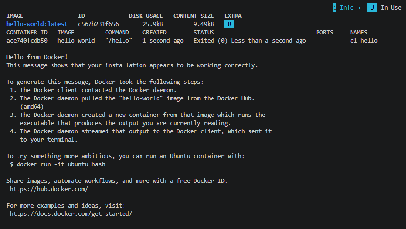
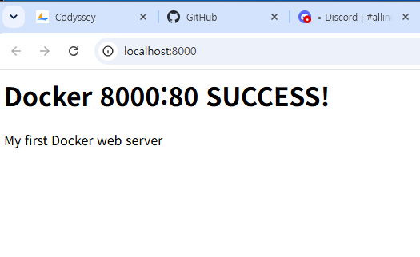
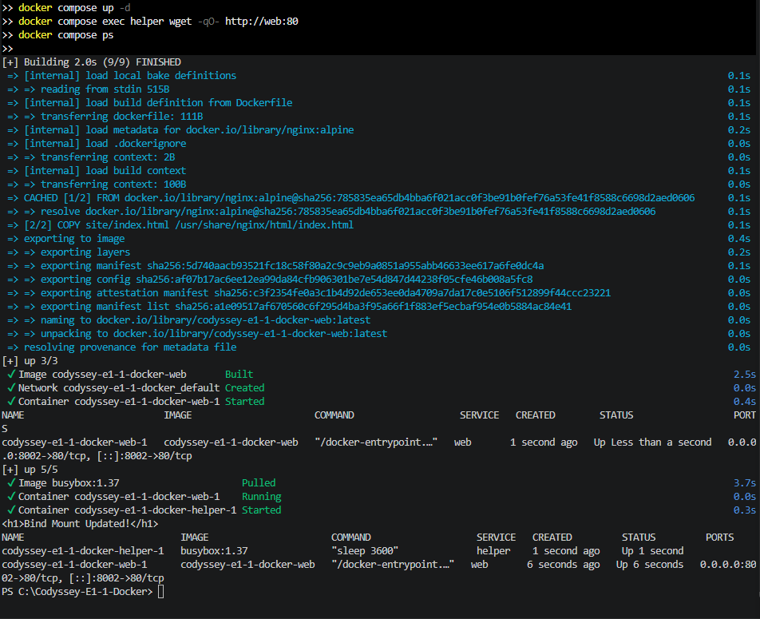


# Codyssey E1-1 — Docker Desktop 개인 복습

## 1. 프로젝트 소개

코디세이 미션 1 평가를 완료한 후, 기존 LabEx 실습을 Windows 10의 Docker Desktop 환경에서 다시 수행한 개인 복습 프로젝트입니다.

기존 터미널, Linux 권한, Git 기초 실습은 [1029_cs](https://github.com/haru1208/1029_cs)에 기록되어 있습니다.

이 저장소에는 Docker Desktop으로 새롭게 수행한 실습과 보너스 과제 결과를 정리했습니다.

## 2. 실행 환경

| 항목 | 환경 |
|---|---|
| OS | Windows 10 (19045.6466) |
| 터미널 | VS Code PowerShell |
| WSL | 3.0.3.0 |
| Docker Desktop | 4.98.0 |
| Docker Engine | 29.9.2 |
| Docker Compose | v5.6.1 |
| 작업 경로 | C:\Codyssey-E1-1-Docker |

## 3. Docker 실습

### 기본 실행

```powershell
docker --version
docker info
docker compose version
docker run --name e1-hello hello-world
docker images
docker ps -a
docker logs e1-hello
```

결과: Hello from Docker! 출력, Exited (0) 정상 종료



### Ubuntu 컨테이너

```powershell
docker run -it --name e1-ubuntu ubuntu bash
```

Ubuntu 26.04.1 LTS 환경에서 pwd, whoami, ls -la, echo, cat 명령어 실행 성공.

### Dockerfile 및 웹 서버

NGINX Alpine 이미지를 기반으로 HTML 페이지를 포함한 커스텀 이미지를 제작했습니다.

```powershell
docker build -t e1-web:1.0 .
docker run -d --name e1-web -p 8000:80 e1-web:1.0
```

브라우저에서 http://localhost:8000 접속 성공.



### 바인드 마운트

Windows의 site/index.html을 컨테이너에 연결했습니다.

파일 수정 전:
`Docker 8000:80 SUCCESS!`

파일 수정 후:
`Bind Mount Updated!`

컨테이너 재빌드 없이 변경 사항이 반영됨을 확인했습니다.

### Docker 볼륨

```powershell
docker volume create e1-data
docker run --name e1-vol-before -v e1-data:/data ubuntu bash -c 'echo Persistent_Data_OK > /data/proof.txt && cat /data/proof.txt'
docker rm e1-vol-before
docker run --rm --name e1-vol-after -v e1-data:/data ubuntu cat /data/proof.txt
```

컨테이너 삭제 후에도 Persistent_Data_OK가 출력되어 데이터 영속성을 확인했습니다.

## 4. 보너스 과제

### Docker Compose

compose.yaml을 작성하여 웹 서버와 BusyBox 보조 컨테이너를 함께 실행했습니다.

```powershell
docker compose up -d --build
docker compose ps
docker compose exec helper wget -qO- http://web:80
docker compose logs --tail 10 web
docker compose down
```

컨테이너 간 HTTP 통신 및 정상 종료를 확인했습니다.



### 환경 변수

APP_MODE를 review로 설정하고 보조 컨테이너를 다시 생성했습니다.

`docker compose exec helper printenv APP_MODE`

출력 결과: `review`

### GitHub SSH

ED25519 SSH 키 생성 및 GitHub 공개키 등록을 완료했습니다.

```powershell
ssh -T git@github.com
```

출력 결과:

`Hi haru1208! You've successfully authenticated, but GitHub does not provide shell access.`

이후 Git 원격 저장소 연결을 HTTPS에서 SSH로 변경했습니다.

## 5. 문제 해결 기록

### Docker Desktop 설치 실패

문제: Virtual Machine Platform 기능 비활성화로 설치 실패

해결:
- Windows 가상 머신 플랫폼 활성화
- WSL 선택적 기능 활성화
- WSL 3.0.3 설치
- Windows 재부팅
- Docker Desktop 재설치 및 엔진 실행 확인

### WSL 명령어 오류

문제: wsl --version 및 wsl --update에서 버전 대신 도움말 출력

해결: Windows 기능 활성화 후 Microsoft 공식 WSL MSI 설치 파일 사용

결과: WSL 3.0.3.0 정상 확인

## 6. 학습 정리

이번 개인 복습을 통해 Docker Desktop 설치부터 이미지, 컨테이너, 포트 매핑, 바인드 마운트, 볼륨, Compose 및 SSH 인증까지 실제 Windows 환경에서 확인했습니다.

기존 LabEx 실습에서 확인하지 못했던 localhost:8000 브라우저 접속도 성공했습니다.

